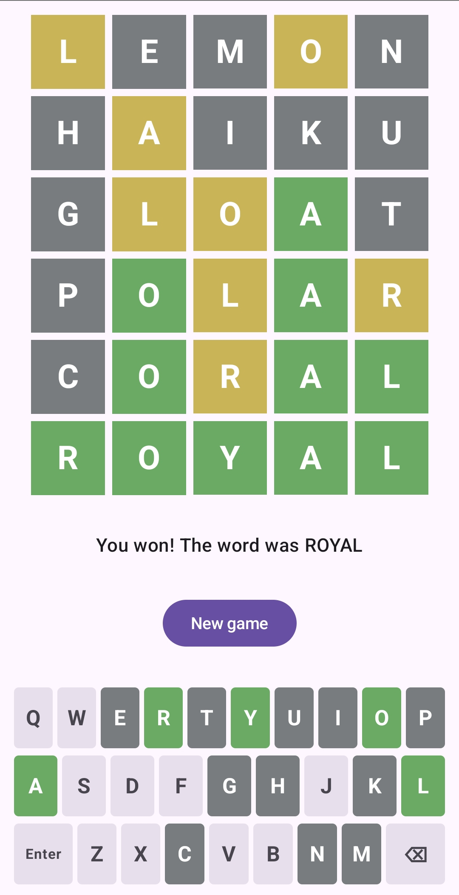

# Wordle Clone

A quick demo project, built to test the `deliver-brief` Claude skill from [jodysalt/skills](https://github.com/jodysalt/skills).

The whole repo came from this one prompt:

```
/deliver-brief Can you build me a wordle clone for an android device. I want to be
  able to test the clone on my phone.
```

The skill took that brief through the spec-driven workflow with no human turns: it filled in `docs/vision.md`, drafted an initiative and a ticket, broke the ticket into tasks, implemented them, and closed what it finished. The planning docs are in `docs/`.

## What it is

An offline Wordle-style game for Android, written in Kotlin and Jetpack Compose. Each game picks a random five-letter word from a bundled list, and you get six guesses. It has no daily word and no network access.



## Build and run

You need JDK 17 and the Android SDK (platform 34).

```sh
./gradlew assembleDebug        # builds app/build/outputs/apk/debug/app-debug.apk
./gradlew testDebugUnitTest    # runs the game-logic unit tests
```

To put it on a phone, run `adb install -r app/build/outputs/apk/debug/app-debug.apk`. You can also copy the APK to the phone and open it there, once you have allowed installs from unknown sources.

## Licence

MIT – see [LICENSE](LICENSE). The bundled word lists come from the public-domain ENABLE list; see `app/src/main/assets/WORDLISTS_NOTICE.md`.
